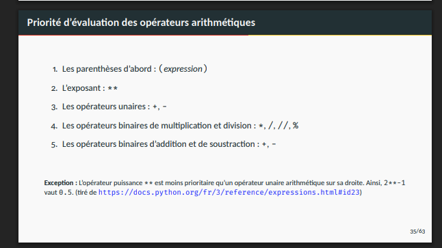
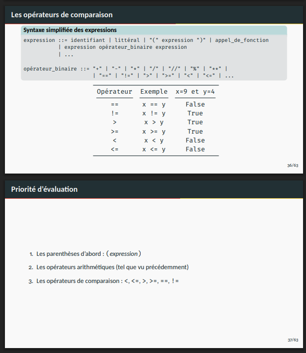
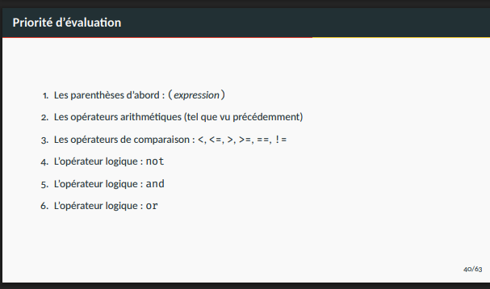

# main topics

- Algorithms Vs psuedo code
- Reading and manual tracing

mutable and immutable data structures
mutable : lists, dictionaries, sets
immutable : tuples, strings, integers, floats, booleans

### "//" vs "/" and "%"

> note the type of the result of each operation

- // : type(num1 // num2) = int - the whole number of the division without the remainder
- / : type(num1 / num2) = float - the whole result of the
- % : type(num1 % num2) = int - remainder of the division

### conditional statements

if, elif, else

```python
if condition1:
    # code block 1
elif condition2:
    # code block 2
else:
    # code block 3
```

---

#### loops

### while loop

```python
counter = 0

while counter < 5:
    print(counter)
    counter += 1
```

### for loop

```python
for i in range(0, 5):
    print(i)

#######

for element in liste:
    print(element)

```

---

### priotity of operations

## 





---

### formatting

```python
num_1 = 30
num_2 = 40

print(f"{num_1} and {num_2}")
```

## fonction `range()`

> range(start, end, steps)

```python

range(2, 4) # 2, 3
range(0, 10, 2) # 0, 2, 4, 6, 8

```

## fonction

> arguments vs parameters

```python

def nom_function(param1, param2):

    return param1 + param2

result = nom_function(arg1, arg2)
```

### Types de données complexes

#### List

methods

```python

sample_list = [1,3,4,5, [2,34,56,34], "ISMAEL", 2.0, "Python", False]
# TODO : Accès aux éléments

sample_list[ -1]
sample_list[0:3]
sample_list[2:]
sample_list[:3]

sample_list.append("Loko") # add the element at the end of the list
sample_list.insert("Loko") # add the element at the start of the list (default index is 0)
sample_list.insert(3, "Loko") # add the element at index 3 of the list
sample_list.pop() # remove the last element in the string and return the element # default index -1
sample_list.pop(2) # remove and the return the element at index 2


"a,b,c".split(",") # ["a", "b", "c"]
```

Reference

```python
>>> a = [1,2,3]
>>> b = a
>>> b.append(4)
>>> a
[1, 2, 3, 4]
>>> b = a.copy()
>>> b.append(5)
>>> b
[1, 2, 3, 4, 5]
>>> a
[1, 2, 3, 4]
>>>

>>> float("3.14")
3.14
>>> int("3.14")
Traceback (most recent call last):
  File "<python-input-47>", line 1, in <module>
    int("3.14")
    ~~~^^^^^^^^
ValueError: invalid literal for int() with base 10: '3.14'
>>> int("3")
3
>>> int(3.24)
3
>>> int("3.24")
Traceback (most recent call last):
  File "<python-input-50>", line 1, in <module>
    int("3.24")
    ~~~^^^^^^^^
ValueError: invalid literal for int() with base 10: '3.24'
>>> float("3.24")
3.24
>>>

int(3.14)    # number -> truncate -> 3
int("3")     # string that looks like an int -> 3
int("3.14")  # string that does NOT look like an int -> ValueError
```
